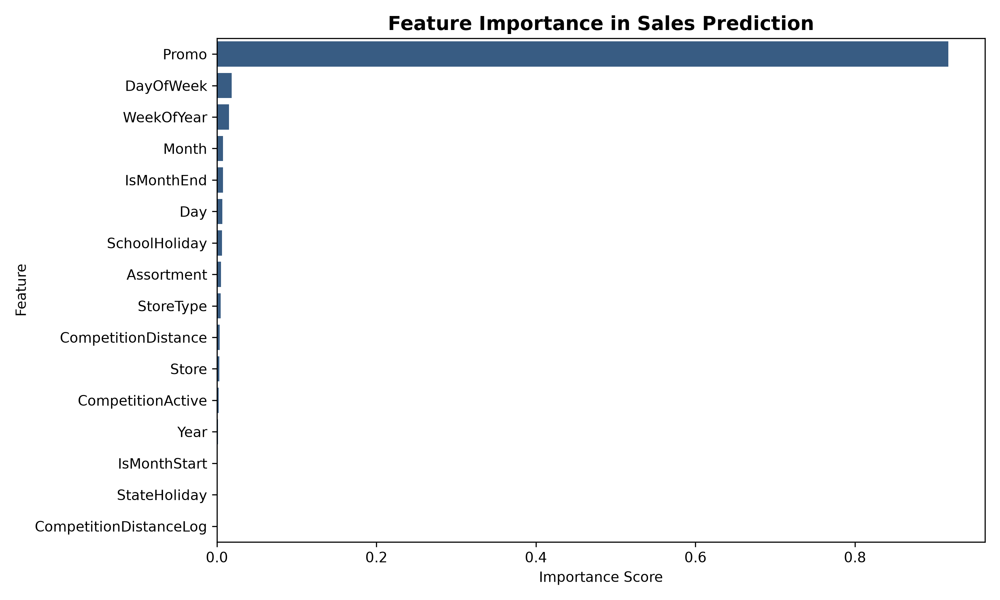

# Retail Store Sales Forecasting & Demand Analytics

An end-to-end machine learning pipeline and interactive forecasting interface built to predict daily store sales across 1,115 European retail stores. The solution combines calendar seasonality, store profiling, competitor proximity dynamics, and promotional schedules into a gradient-boosted regression engine, served via a Streamlit decision-support dashboard.



---

## Performance Summary

The model is evaluated using a strict chronological holdout (the final 6 weeks of data from `2015-06-15` onward), preventing lookahead bias common to standard random cross-validation.

| Metric | Validation Score | Interpretation |
|---|---|---|
| **RMSPE** | **19.13%** | Root Mean Square Percentage Error (primary metric) |
| **RMSE** | **€1,144.20** | Root Mean Squared Error |
| **MAE** | **€831.64** | Mean Absolute Error across all open stores |

Key drivers of daily volume include active promotional periods (`Promo`), store assortment tier, competition distance, and weekday traffic spikes.

---

## Pipeline Architecture

```
├── data/
│   ├── store.csv               # Store metadata (type, assortment, competition)
│   ├── train.csv               # Historical daily sales & customer volume
│   └── test.csv                # Holdout test set
├── models/
│   └── sales_model.joblib      # Serialized model artifact & store profiles
├── app.py                      # Interactive Streamlit forecasting app
├── stores_analysis.py          # Feature engineering, temporal split & training pipeline
├── requirements.txt            # Project dependencies
└── README.md
```

### Feature Engineering Highlights
* **Temporal Decomposition:** Julian day, day of week, week of year, month, start/end of month flags.
* **Competitor Proximity:** Non-linear log-transformation of distance (`log1p(CompetitionDistance)`) and temporal competitor opening flags.
* **Operational Factors:** State holiday classification (public, Easter, Christmas), school holiday presence, store layout classification, and promotion schedules.

---

## Quickstart

### 1. Environment Setup

```bash
# Clone the repository
git clone https://github.com/your-username/retail-store-forecasting.git
cd retail-store-forecasting

# Create and activate virtual environment
python3 -m venv .venv
source .venv/bin/activate

# Install dependencies
pip install -r requirements.txt
```

### 2. Dataset Setup

Download the [Rossmann Store Sales](https://www.kaggle.com/c/rossmann-store-sales/data) dataset files (`train.csv`, `store.csv`, and optionally `test.csv`) and place them into the `data/` directory. *(Note: CSV files and heavy binaries are excluded via `.gitignore` to keep the repository lightweight.)*

### 3. Train the Model

To run the complete data pipeline, generate features, train the gradient booster, and export model artifacts:

```bash
python stores_analysis.py --model-type xgboost --n-estimators 500
```

Available flags:
* `--store-path`: Path to `store.csv` (default: `data/store.csv`)
* `--sales-path`: Path to `train.csv` (default: `data/train.csv`)
* `--split-date`: Temporal validation cutoff (default: `2015-06-15`)
* `--model-type`: Regressor choice: `xgboost` or `lightgbm` (default: `xgboost`)
* `--n-estimators`: Boosting rounds (default: `500`)

### 4. Launch Interactive Dashboard

```bash
streamlit run app.py
```

The application will start locally at `http://localhost:8501`. Features include:
* **Interactive Geospatial & Catchment Map**: Live map showing the selected store and its surrounding regional retail network. Adjusting the **Competition Distance** slider moves the competitor marker radially closer or further away in real time and dynamically recalculates the competitive catchment zone ($km^2$).
* **Demand Forecasting**: Instant daily revenue inference with percentage comparisons against historical store averages.
* **Customer Footfall Estimation**: Predicts customer volume using historical store-level basket conversion ratios.
* **Historical Trajectory & Seasonality**: Trailing 90-day transaction timeline and day-of-week revenue variance benchmarks.
